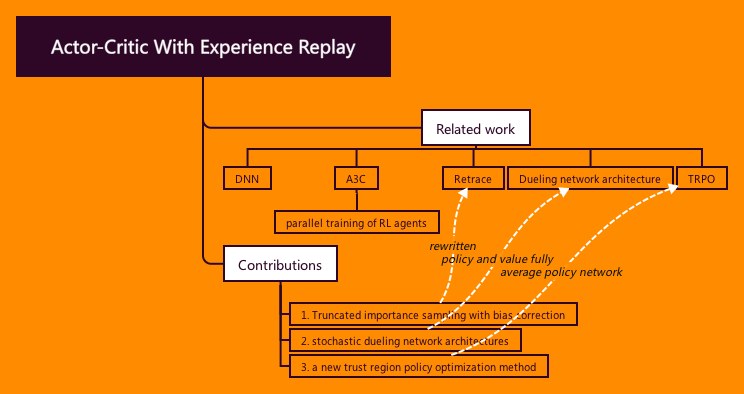

# Actor-Critic with Experience Replay
combining three breakthrough:
1. Truncated importance sampling with bias correction
2. stochastic dueling network architectures
3. a new trust region policy optimization method

Utilize recent developments in 
* deep neural networks, 
* variance reduction techniques, 
* the off-policy Retrace algorithm (Munos et al., 2016) Retrace
* parallel training of RL agents (Mnih et al., 2016) A3C

**Theoretical result:**
Retrace operator can be rewritten from our proposed truncated importance sampling with bias correction technique.

## Mathematical formulation

Let $\rho_t = \frac{\pi(a_t \mid x_t)}{\mu(a_t \mid x_t)}$ denote the off-policy importance ratio and $\bar{\rho}_t = \min(c, \rho_t)$ its truncated counterpart. ACER eliminates bias from truncation by adding an explicit on-policy expectation correction:

$$
\hat{g}^{\text{acer}}_t = \bar{\rho}_t \nabla_\theta \log \pi_\theta(a_t \mid x_t)\!\big(Q^{\text{ret}}(x_t, a_t) - V_\nu(x_t)\big) + \mathbb{E}_{a \sim \pi(\cdot \mid x_t)}\!\left[\left(\frac{\rho_t(a) - c}{\rho_t(a)}\right)_{\!+}\!\nabla_\theta \log \pi_\theta(a \mid x_t)\!\big(Q_\nu(x_t, a) - V_\nu(x_t)\big)\right]
$$

where multi-step off-policy targets $Q^{\text{ret}}$ follow the recursive Retrace backup $Q^{\text{ret}}(x_t, a_t) = r_t + \gamma \bar{\rho}_{t+1}\big[Q^{\text{ret}}(x_{t+1}, a_{t+1}) - Q(x_{t+1}, a_{t+1})\big] + \gamma V(x_{t+1})$ with $\bar{\rho}_{t+1} = \min\!\big(1, \frac{\pi(a_{t+1}\mid x_{t+1})}{\mu(a_{t+1}\mid x_{t+1})}\big)$.

