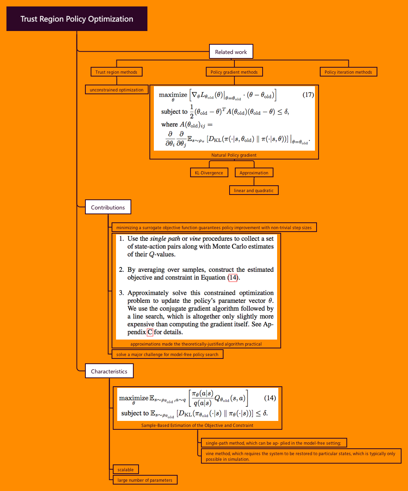

# Trust Region Policy Optimization
John Schulman, Sergey Levine, Philipp Moritz, Michael Jordan, Pieter Abbeel

> **Iterative procedure** for *optimizing policies*, with **guaranteed monotonic improvement**. 

## Big picture:

We have Theory for proving, but need approximations for real play.
Practical algorithm: Trust Region Policy Optimization (TRPO)

## Characteristics of TRPO:

1. natural policy gradient methods 
2. effective for optimizing large nonlinear policies such as neural networks. 

## Experiments:

performs robustly on a wide variety of tasks: 
1. learning simulated robotic swimming, hopping, and walking gaits
2. playing Atari games using images of the screen as input. 

## To remind:

1. approximations deviate from the theory
2. TRPO **tends** to give monotonic improvement, with little tuning of hyperparameters.

## Mathematical formulation

Monotonic improvement theory lower-bounds true policy return $\eta(\tilde{\pi})$ via the local surrogate $L_\pi(\tilde{\pi})$ minus a worst-case KL penalty, which TRPO turns into a trust-region constrained optimization problem around $\theta_{\text{old}}$:

$$
\max_{\theta}\; \mathbb{E}_{s \sim \rho_{\theta_{\text{old}}},\, a \sim \pi_{\theta_{\text{old}}}}\!\left[\frac{\pi_\theta(a \mid s)}{\pi_{\theta_{\text{old}}}(a \mid s)}\, A_{\theta_{\text{old}}}(s, a)\right] \quad \text{s.t.} \quad \mathbb{E}_{s \sim \rho_{\theta_{\text{old}}}}\!\Big[D_{\text{KL}}\!\big(\pi_{\theta_{\text{old}}}(\cdot \mid s)\,\big\|\,\pi_\theta(\cdot \mid s)\big)\Big] \le \delta
$$

Linearizing the objective $g = \nabla_\theta L_{\theta_{\text{old}}}(\theta)\big|_{\theta=\theta_{\text{old}}}$ and quadratically approximating the KL constraint via the Fisher Information Matrix $F_{ij} = \frac{\partial^2}{\partial \theta_i \partial \theta_j}\bar{D}_{\text{KL}}(\theta_{\text{old}} \| \theta)\big|_{\theta=\theta_{\text{old}}}$ yields the natural-gradient search direction solved by conjugate gradients and backtracking line search:

$$
\Delta\theta = \sqrt{\frac{2\delta}{g^\top F^{-1} g}}\, F^{-1} g
$$

